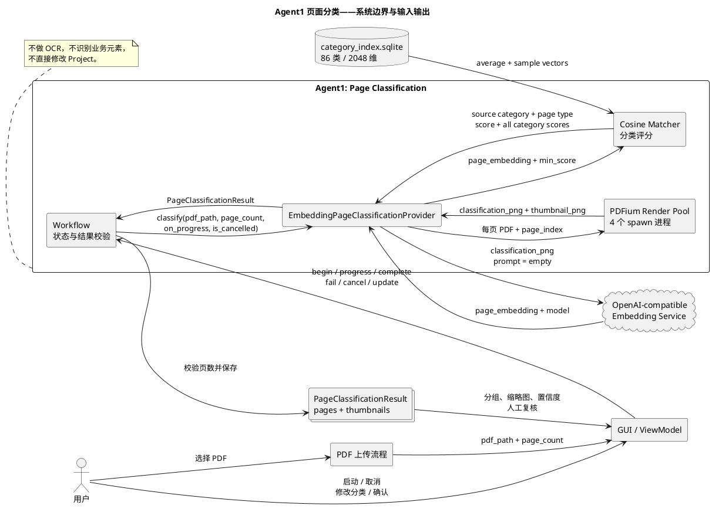
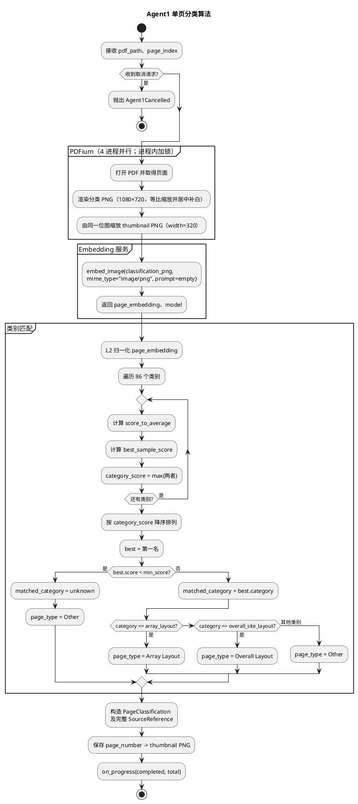
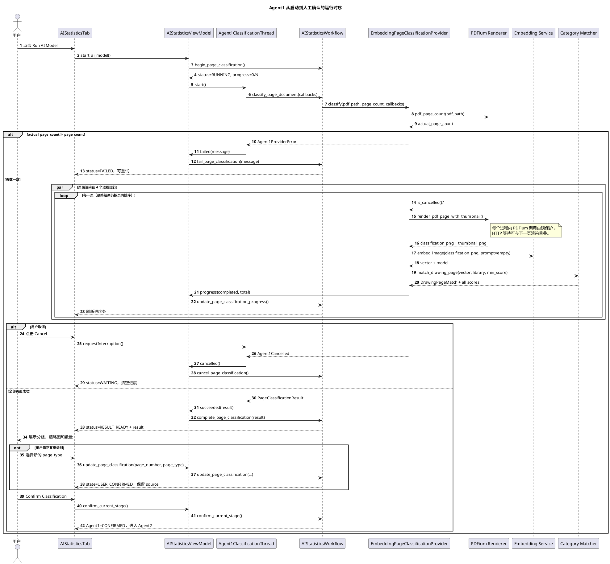

# Agent 1 页面分类设计

## 1. 职责与边界

Agent1 只负责把一份已经上传成功的 PDF 按页分类，并为人工复核准备缩略图和可追溯信息。它不做 OCR、不识别图纸中的业务元素，也不直接修改项目数据。

Agent1 的核心接口是：

```python
PageClassificationProvider.classify(
    pdf_path: Path,
    page_count: int,
    *,
    on_progress: Callable[[int, int], None] | None = None,
    is_cancelled: Callable[[], bool] | None = None,
) -> PageClassificationResult
```

这里的 `page_count` 是 PDF 上传阶段已经得到的页数。Agent1 会重新读取 PDF 的实际页数并校验两者一致，避免上传后文件被替换或修改。

## 2. 输入

### 2.1 直接业务输入

| 输入 | 类型 | 来源 | 约束/用途 |
| --- | --- | --- | --- |
| `pdf_path` | `Path` | PDF 上传流程 | 指向可读取的 PDF 文件 |
| `page_count` | `int` | 上传时由 `QPdfDocument` 得到 | 必须大于 0，并与 Agent1 运行时读取的实际页数相等 |

### 2.2 运行依赖与策略输入

| 输入 | 当前实现 | 用途 |
| --- | --- | --- |
| Embedding 服务配置 | `EmbeddingConfig` | 服务地址、模型、2048 维输出、超时、并发等 |
| 类别向量库 | `category_index.sqlite` | 86 个源类别（REVAMP 34 类、EVS 52 类）；每类含平均向量和参考图片向量 |
| 最低匹配阈值 | `DRAWING_CLASSIFICATION_MIN_SCORE`，默认 `0.675` | 最高分低于阈值时记为 `unknown` |
| 渲染进程数 | `AGENT1_RENDER_PROCESSES`，默认 `4` | 每个进程使用独立 PDFium 状态并行渲染 |
| Embedding 并发 | `AGENT1_EMBEDDING_CONCURRENCY`，默认 `8` | 独立线程池中的 HTTP 请求数 |
| 最大在途页数 | `AGENT1_MAX_IN_FLIGHT`，默认 `12` | 限制渲染结果和待处理请求的内存占用 |

类别向量和页面向量必须在同一个向量空间中生成。因此 Agent1 只提交页面 PNG，用户文本必须为空；改变提示文本会导致余弦分数失真。

### 2.3 控制输入

| 输入 | 类型 | 语义 |
| --- | --- | --- |
| `on_progress(completed, total)` | 可选回调 | 每完成一页后报告进度；并发运行时完成顺序不等于页码顺序 |
| `is_cancelled()` | 可选回调 | 每页开始前协作式检查取消请求 |

## 3. 单页处理规则

对 PDF 的每一页执行以下步骤：

1. PDFium 将页面等比渲染并居中补白为固定 1080×720 px 的分类 PNG，完整保留页面内容。
2. 从同一次渲染结果缩放出宽度 320 px 的 PNG 缩略图，避免 GUI 再次栅格化 PDF。
3. Embedding 服务把 1080×720 px 分类 PNG 转成页面向量。
4. 页面向量与每个类别的平均向量、所有参考图片向量分别计算余弦相似度。
5. 每个类别的最终分数为：

   `category_score = max(score_to_average, best_sample_score)`

6. 取分数最高的源类别。如果最高分低于 `min_score`，源类别改为 `unknown`。
7. 将源类别折叠为前端稳定的三种页面类型：

| 源类别 | 输出 `page_type` |
| --- | --- |
| `array_layout` | `Array Layout` |
| `overall_site_layout` | `Overall Layout` |
| 其余 31 类或 `unknown` | `Other` |

PDFium 本身不是线程安全的，因此单个进程内仍由全局锁保护；Agent1 使用
4 个 `spawn` 渲染进程，每个进程拥有独立 PDFium 状态和文档实例。渲染结果
进入独立 Embedding 线程池，并由最大在途页数形成有界流水线。任务可以乱序
完成，但最终 `pages` 始终按页码排序。

## 4. 输出

### 4.1 成功输出

`PageClassificationResult` 是 Agent1 的唯一成功返回对象：

```text
PageClassificationResult
├── pages: tuple[PageClassification, ...]
│   └── PageClassification
│       ├── page_number: int
│       ├── page_type: str
│       ├── purpose: str                 # 命中的源类别或 unknown
│       ├── state: RecognitionState      # 初始为 AI_DRAFT
│       └── source: SourceReference
│           ├── page_number: int
│           ├── confidence: float        # 胜出类别分数，裁剪到 [0, 1]
│           ├── model_version: str       # Embedding 服务返回的模型名
│           ├── recognition_version: str # agent1-cosine-v4-1080x720
│           ├── source: str              # embedding:category-vectors
│           └── raw
│               ├── matched_category
│               ├── min_score
│               └── category_scores[]    # 86 类的完整评分明细
├── thumbnails: dict[int, bytes]         # 页码 -> 320 px PNG
└── page_images: Mapping[int, bytes]     # 按需渲染的高分辨率页面映射
```

必须满足以下输出不变量：

- `len(pages) == page_count`；否则工作流拒绝接收结果。
- `pages` 按 `page_number` 升序排列。
- 每页有且只有一个稳定页面类型：`Array Layout`、`Overall Layout` 或 `Other`。
- `thumbnails` 以 1 起始页码为键，供分类复核界面直接显示。
- `page_images` 以 1 起始页码为键；初始化时不生成高清图，首次访问某页时才
  渲染并缓存保持原始比例、不添加画布白边的高分辨率 PNG。Agent2/Agent3
  可通过 `images_for_type(page_type)` 取得人工复核后指定类型的页面。
- 每页渲染、PNG 编码、Embedding、高清懒加载和任务汇总都会写入滚动日志，
  包含耗时、图片字节数、当前工作集和峰值工作集。
- 初次 AI 输出状态为 `AI_DRAFT`；用户修改某页分类后，该页状态变为 `USER_CONFIRMED`，原始 `source` 追溯信息保留。

### 4.2 过程输出与工作流状态

Agent1 本身通过进度回调输出 `(completed, total)`。GUI/ViewModel 将它写入 `AIStatisticsSnapshot` 并展示进度条。

| 事件 | 页面分类阶段状态 | 其他输出 |
| --- | --- | --- |
| 开始 | `RUNNING` | 进度设为 `0/page_count` |
| 单页完成 | `RUNNING` | 更新完成页数 |
| 全部成功 | `RESULT_READY` | 保存 `PageClassificationResult`，允许人工修改和确认 |
| 用户确认 | `CONFIRMED` | 进入 Agent2 / `INFO_RECOGNITION` |
| 取消 | `WAITING` | 清空进度，可重新运行 |
| 失败 | `FAILED` | `error_message` 保存错误，可重试 |

### 4.3 异常输出

| 异常 | 触发条件 |
| --- | --- |
| `Agent1Cancelled` | 检测到用户取消请求 |
| `Agent1ProviderError` | PDF 页数变化、渲染失败、Embedding 失败、类别库损坏或其他分类异常 |

## 5. PlantUML：Agent1 边界与输入输出



## 6. PlantUML：单页分类活动图



## 7. PlantUML：完整运行时序图



## 8. 实现位置

| 内容 | 文件 |
| --- | --- |
| Agent1 Provider 与并发编排 | `src/count_and_design/application/ai_statistics/page_classification.py` |
| 类别向量加载和余弦评分 | `src/count_and_design/application/ai_statistics/category_vectors.py` |
| PDFium 渲染与缩略图 | `src/count_and_design/application/ai_statistics/pdf_rendering.py` |
| 输入/输出数据结构 | `src/count_and_design/application/ai_statistics/models.py` |
| Agent1 工作流状态 | `src/count_and_design/application/ai_statistics/workflow.py` |
| 后台线程与 GUI 状态桥接 | `src/count_and_design/gui/viewmodels/ai_statistics.py` |
| 分类复核页面 | `src/count_and_design/gui/views/ai_statistics/pages/classification.py` |
