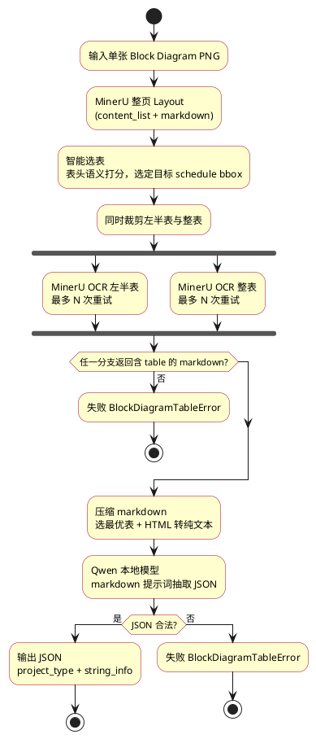
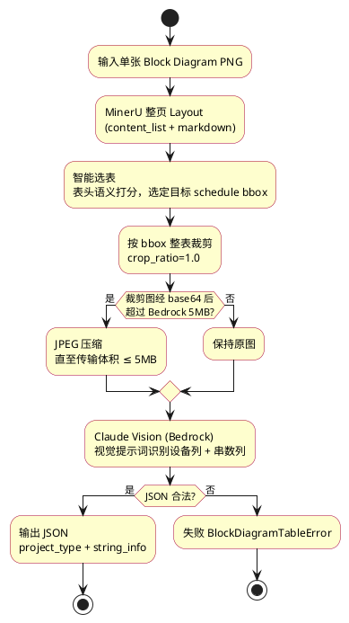
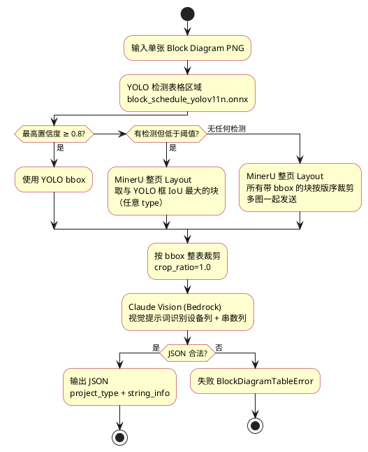

# Block Diagram 表格识别 — 开发流程

三种策略共用入口 `BlockDiagramTableRecognizer.recognize()`，由 `.env` 中 `BLOCK_DIAGRAM_TABLE_STRATEGY` 切换：

- `mineru_qwen` — MinerU 定位 + OCR + Qwen 文本理解
- `mineru_claude` — MinerU 定位 + 整表裁剪 + Claude Vision（Bedrock）
- `yolo_claude` — YOLO 定位表格区域（置信度 < 0.8 或无检测时由 MinerU 纯文本启发式智能选表）+ 整表裁剪 + Claude Vision

定位与抽取是两个独立阶段：`recognize()` = `locate()` + `extract_table_from_location()`。

- `locate()` 只做定位，不调用任何 LLM；定位失败直接报错，**不会发起 Claude 请求**。
- 定位成功但抽取失败（HTTP 5xx、JSON 非法、无有效行等）时，异常 `BlockDiagramTableError.location` 携带已定位的区域；页面结果、调试导出与窗口依旧绘制该 bbox。

核心代码：`src/count_and_design/application/ai_statistics/element_recognition/block_diagram_table/`

所属阶段：**Agent3 / Element Recognition**（与 Agent2 Info Recognition 的 OCR 方案独立）

底层依赖 `application/ai/` 的 MinerU OCR、Qwen LLM、Bedrock Claude。

| 模块 | 职责 |
|------|------|
| `element_recognition/block_diagram_table/recognizer.py` | 入口；`locate()` 定位、`extract_table_from_location()` 抽取两阶段 |
| `element_recognition/block_diagram_table/common.py` | 类型（`TableLocation`）、文本启发式选表、markdown、图像、LLM 解析 |
| `element_recognition/block_diagram_table/prompts.py` | 提示词 |

---

## 共用：MinerU 整页 Layout

两种方案第一步相同：对**原图**调用 MinerU（`parse_method=ocr`, `table_enable=true`, `return_content_list=true`），得到：

- `content_list` — 版面块列表（含多个 `type=table` 及 bbox）
- `markdown` — 整页 OCR 结果（可含多个 `<table>` HTML）

### 智能选表（表头语义，不依赖位置）

当一页含多张表（如 South Platte：KEY PLAN、LEGEND、DC SCHEDULE 等）时，**不再按 bbox 面积最大**选表，而是：

1. 从 layout `markdown` 提取所有 `<table>`
2. 对每个表按**表头**打分：须同时存在
   - **设备列**：`FROM`、`LOAD BREAK DISCONNECT`、`COMBINER BOX` 等
   - **串数列**：`STRINGS`、`NUMBER OF STRINGS`、`STRING COUNT` 等
3. 排除 LEGEND / KEY PLAN / INFORMATION 等汇总表
4. 将匹配表在 `content_list` 中的序号与 bbox 对齐，供后续裁剪

---

## mineru_qwen 流程



### 步骤说明

| 步骤 | 说明 |
|------|------|
| 智能选表 | 多表图纸只选设备 schedule，避免 KEY PLAN / LEGEND |
| 左半裁剪 OCR | 对选中表区域重新 OCR，提高行完整性 |
| 整表 OCR | 与左半裁剪同时提交，各自独立重试，采用首个有效表格结果 |
| Markdown 预处理 | 选最优表、去噪、HTML 转纯文本，控制 Qwen 上下文长度 |
| Qwen 抽取 | **始终**由 Qwen 理解 OCR markdown 并输出 JSON |

### 输出 JSON 格式

```json
{
  "project_type": "LYNX",
  "string_info": [
    {"node": "INV31A106_LBD_01", "string_number": 12}
  ]
}
```

---

## mineru_claude 流程



### 步骤说明

| 步骤 | 说明 |
|------|------|
| 智能选表 | 与 qwen 相同逻辑，保证裁剪的是 DC SCHEDULE 而非 KEY PLAN |
| 整表裁剪 | Claude 直接读图，需要完整表格网格 |
| 体积压缩 | PNG 原图可能 <5MB，base64 后超限，需转 JPEG |
| Vision 提示词 | 要求识别 schedule 表中的设备列与串数列；忽略 LEGEND / 布局标注 |
| 无 Qwen / 无 HTML 解析 | 抽取逻辑完全由 Claude 视觉完成 |

### Vision 提示词要点

- 只读**设备 schedule 表**（同时有设备/source 列 + 串数列）
- 忽略 LEGEND、KEY PLAN、INFORMATION、REVISION
- 每个设备 ID 一行；OPEN AIR / DIRECT BURY 等安装类型行需合并
- node 按图纸原文保留（hyphen / underscore / 前导零）
- 仅输出 JSON，无多余说明

---

## yolo_claude 流程



### 步骤说明

| 步骤 | 说明 |
|------|------|
| YOLO 定位 | 使用 `block_schedule_yolov11n.onnx` 检测 schedule 表区域 |
| MinerU 补偿 | YOLO 最高置信度 < `AGENT3_YOLO_BLOCK_SCHEDULE_FALLBACK_CONFIDENCE`（默认 0.8）时，**忽略 YOLO bbox 的坐标，但把它当作指针**：调用 MinerU 整页 layout，取与 YOLO 框 **IoU 最大**的布局块（`table` / `image` / `text` 等**任意 type** 均可），裁剪该块返回。YOLO 完全没有检测时，回退 MinerU 并把**所有**带 bbox 的布局块按版序裁剪成多图，一次性发给表格提取模型，不做任何筛选 |
| 整表裁剪 + Claude | 与 `mineru_claude` 相同：整表裁剪后 Bedrock Claude Vision 抽取 JSON |
| 失败语义 | 定位失败：报 `BlockDiagramTableError` 且**不发起 Claude 请求**，页面无 bbox；抽取失败（HTTP 5xx/JSON 非法/无有效行）：异常携带 `location`，页面结果仍带 `table_bbox`/`table_bbox_source`，窗口照常绘制 |
| 调试字段 | 成功：`raw_output.table_bbox_source` 为 `yolo` 或 `mineru`；`raw_output.yolo_confidence` 记录 YOLO 最高置信度。失败：`table_recognition.location` 记录已定位的 bbox/source/locate 元数据 |

---

## 方案对比

```plantuml
@startuml comparison
skinparam backgroundColor white
skinparam packageStyle rectangle

together {
  package "共用" as shared {
    [MinerU 整页 Layout] as M
    [智能选表\n表头语义] as S
    M --> S
  }
}

together {
  package "mineru_qwen" as qwen {
    [左半裁剪 OCR] as Q1
    [整表 OCR] as Q2
    [Markdown 预处理] as Q3
    [Qwen 文本] as Q4
    Q1 --> Q3
    Q2 --> Q3
    Q3 --> Q4
  }
}

together {
  package "mineru_claude" as claude {
    [整表裁剪] as C1
    [Bedrock 压缩] as C2
    [Claude Vision] as C3
    C1 --> C2 --> C3
  }
}

S --> Q1
S --> C1

@enduml
```

| 维度 | mineru_qwen | mineru_claude |
|------|-------------|---------------|
| 定位 | MinerU layout + 智能选表 | 同左 |
| 裁剪 | 左半与整表并行，首个有效结果获胜 | 始终整表 |
| 主抽取 | Qwen 文本（OCR markdown） | Claude 视觉 |
| 多表图纸 | 智能选表 + 提示词 | 选表 + vision 提示词 |
| 成本 / 延迟 | 中（layout + 裁剪 OCR + Qwen） | 较高（每图调 Bedrock） |
| 典型优势 | 结构化表、可离线 | 复杂/非标表、高准确率 |

---

## 调试与 Benchmark

| 工具 | 用途 |
|------|------|
| `test_scripts/run_block_diagram_table_debug.py` | dump layout md、content_list、bbox、裁剪图、OCR md |
| `test_scripts/run_block_diagram_benchmark.py` | 对比两策略与 ground truth |
| `benchmark/ground_truth/*.json` | 标注答案 |
| `ocr_outputs/mineru/`、`ocr_outputs/claude/` | 预测结果缓存 |

### 相关环境变量

```env
BLOCK_DIAGRAM_TABLE_STRATEGY=yolo_claude     # Agent3 默认；可切换为 mineru_claude
AGENT3_YOLO_BLOCK_SCHEDULE_CONFIDENCE=0.25
AGENT3_YOLO_BLOCK_SCHEDULE_FALLBACK_CONFIDENCE=0.8
BLOCK_DIAGRAM_TABLE_LEFT_CROP_RATIO=0.5
BLOCK_DIAGRAM_TABLE_MINERU_CROP_MAX_ATTEMPTS=3
BLOCK_DIAGRAM_TABLE_MAX_COMPLETION_TOKENS=1024
BLOCK_DIAGRAM_TABLE_QWEN_MAX_CONTEXT_TOKENS=12288
BLOCK_DIAGRAM_TABLE_QWEN_PROMPT_RESERVE_TOKENS=2500
BLOCK_DIAGRAM_TABLE_BEDROCK_MAX_TRANSPORT_BYTES=5242880
```

### PlantUML 预览

VS Code 可安装 [PlantUML](https://marketplace.visualstudio.com/items?itemName=jebbs.plantuml) 插件预览；或在线渲染：<https://www.plantuml.com/plantuml/uml/>

---

## 版本演进（相对早期流程图）

| 早期 | 当前 |
|------|------|
| 按 bbox **面积最大**选表 | 按**表头语义**选表（`mineru_qwen` / `mineru_claude`） |
| qwen HTML 解析为主、Qwen 兜底 | **始终由 Qwen** 理解 OCR markdown |
| 固定 LBD/CBX 编号 pattern | 表头语义选表，行内 ID **格式无关** |
| claude 无选表优化 | 与 qwen **共用**智能选表 |
| 低置信度 YOLO 框与 MinerU 块按 IoU 匹配 | 低置信度：把 YOLO 框当指针，取 **IoU 最大**的布局块（**任意 type**） |
| 无检测时用纯文本启发式选表 | 无检测：**所有**布局块裁剪成多图一起发送，不做筛选 |

### yolo 策略的定位细节

- **低置信度 ≠ 丢弃 YOLO**。`select_yolo_table_bbox()` 会用 `confidence=0.0` 再取一次最高分框，
  作为 IoU 匹配的参考框。YOLO 的坐标空间是归一化 0..1，MinerU layout 是 0..1000，
  匹配前经 `scale_bbox_between_spaces()` 统一到 0..1000（`LAYOUT_SPACE_SIZE`）。
- **不再使用表头语义选表**。之前 `select_table_bbox()` 在语义打分全部失败时会退化为
  "面积最大的 `type=table` 块"，实测会把平面图图例（单列伪表格）当成表格。
  `mineru_qwen` / `mineru_claude` 仍走 `select_table_bbox()`，未改动。
- **多图抽取**：`extract_table_json_from_image()` 接受 `bytes` 或 `bytes` 序列，
  序列时逐张压缩后经 `complete_with_images()` 单次请求发送（Bedrock / OpenRouter 均已支持）。
- **调试字段**：`raw_output.region_selection` 取 `yolo_box` /
  `mineru_iou_with_yolo` / `all_mineru_blocks` / `yolo_box_after_mineru_failure`；
  另有 `region_kind`、`region_count`、`table_bboxes`、`table_region_kinds`、
  `table_crop_paths`。失败时 `location.regions` 记录每个区域及其 `kind` / `block_index`。
- **GUI**：`ElementPageResult.table_bboxes` 携带全部区域，画布逐个绘制；
  多区域时标注为 "表格区域 i/N"。单区域时标签仍为 "YOLO 识别" / "MinerU 识别"。
