# Count and Design：Codex、MCP 与 Agent 工作流技术架构

> 核对日期：2026-11-02。本文依据当前工作区源码（包含尚未提交的修改），描述已实现行为。模型服务与并发参数可由环境配置覆盖；文中的默认策略指代码默认值。图中的 Agent1–4 是应用内部的业务阶段。
>
> 阅读方式：支持 Mermaid 的 Markdown 查看器可直接渲染本文流程图；普通文本查看器会显示图表源码。

## 1. 系统职责与总体架构

Codex 根据用户任务读取结果、分析图纸、选择工具并提出修正。MCP 服务注册工具，将调用送到指定桌面窗口。Count and Design 持有项目与识别状态，执行模型推理、几何重建、校验和界面刷新。

| 组成 | 主要职责 | 关键实现 |
| --- | --- | --- |
| Codex | 理解任务、编排工具、查看证据、分析疑点、提出修改 | 通过 MCP Client 调用工具 |
| MCP 服务进程 | 工具注册、参数描述、窗口发现与连接、请求转发、图片封装 | `FastMCP`、`BridgeClient` |
| 桌面 GUI 进程 | 业务状态、任务控制、审阅会话、纠错发布、界面同步 | `GuiBridge`、`ReviewSession`、ViewModel |
| Agent3 子进程 | 隔离阻塞网络调用与本地 ONNX 推理，提供可终止的执行边界 | `Agent3ProcessRunner` |
| 外部 AI 服务 | Embedding、OCR、视觉模型推理 | `application/ai/` 中的客户端和 Provider |

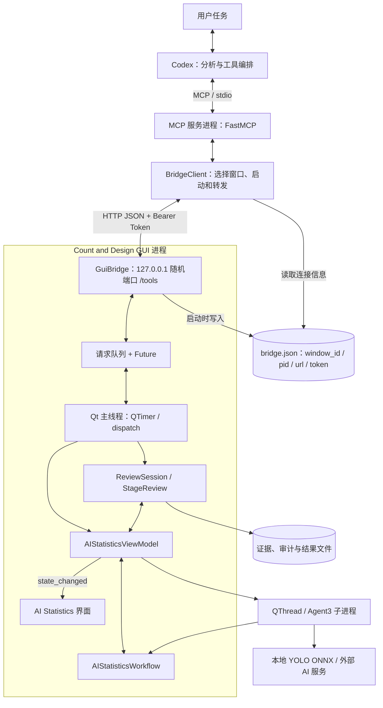

### 1.1 应用内部的分层关系

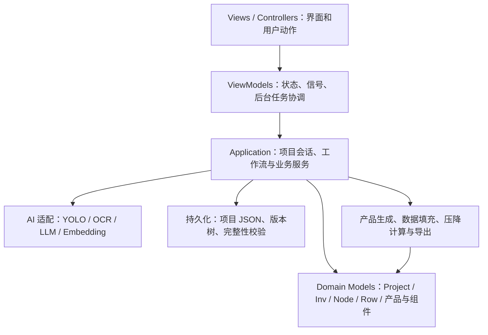

当前 MCP 主要连接 AI Statistics 的识别与复核流程。正式 Count 项目由 `AppViewModel` / `ProjectSession` 管理，识别草稿经过既有确认、校验和导入流程后进入正式项目。

## 2. MCP 的实现与调用链

### 2.1 入口、工具注册与传输

同一个打包 EXE 通过参数选择运行模式：

- `--mcp`：进入 `integration/mcp_server.py`，执行 `create_server().run(transport="stdio")`。
- GUI 模式：启动 PySide6 窗口；`--codex-bridge <discovery.json>` 指定桥接发现文件。打包版普通启动默认启用桥接。
- MCP 通过 `BridgeClient.start()` 连接已有窗口，必要时启动带桥接参数的 GUI 进程。

MCP 工具通过 `@server.tool()` 注册。FastMCP 根据函数签名、类型注解和文档字符串描述工具及参数。典型工具包装如下：

```python
@server.tool()
def start_recognition(
    stage: str | int = "all",
    panel_orientation: str | None = None,
) -> dict:
    return client.call(
        "start_recognition",
        stage=stage,
        panel_orientation=panel_orientation,
    )
```

`BridgeClient` 读取目标窗口的发现文件，将其转换为本机 HTTP 请求：

```json
{
  "tool": "start_recognition",
  "arguments": {
    "stage": 0,
    "panel_orientation": null
  }
}
```

两段传输分别是 Codex 与 MCP 服务之间的 stdio，以及 MCP 服务与 GUI 之间的本机 HTTP。GUI HTTP 请求要求匹配随机 Bearer Token，并拒绝带浏览器 Origin 的请求。发现文件保存连接元数据与令牌；它不承担项目数据存储。

### 2.2 为什么需要 Qt 主线程桥接

HTTP 服务使用 `ThreadingHTTPServer` 接收请求，将请求和一个 `Future` 放入队列。Qt 主线程上的 `QTimer` 每 100ms 调度一次，每次最多处理一个命令。工具执行结果写回 Future，再沿 HTTP、MCP 返回 Codex。

这样，工具侧和用户界面侧可以共用同一个 ViewModel 与 Workflow，所有桥接业务访问都经过 Qt 主线程。耗时识别通过后台任务执行。

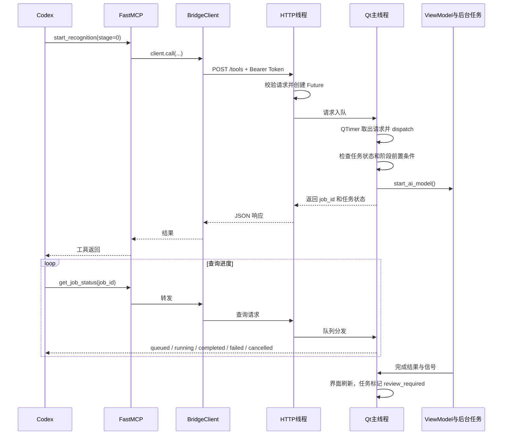

识别工具返回任务句柄，调用方通过状态工具查询完成情况。当前实现没有自动唤醒已结束 Codex 对话的机制。

## 3. MCP 工具清单与业务映射

当前 `create_server()` 共注册 **14 个工具**。

| 分组 | 工具 | 参数摘要 | 对应业务与返回内容 |
| --- | --- | --- | --- |
| 会话 | `list_sessions` | 无 | 列出存活窗口、项目/PDF 状态和当前选择 |
| 会话 | `start_session` | `new_window=False`, `window_id=None` | 连接或启动窗口；后续工具面向该窗口 |
| 输入 | `import_pdf` | `path`, `replace_existing=False` | 导入绝对路径 PDF；保护窗口中已有图纸 |
| 执行 | `start_recognition` | `stage="all"`, `panel_orientation=None` | 启动一个阶段，返回 `job_id` |
| 执行 | `get_job_status` | `job_id=None` | 返回任务、进度、阶段和排队状态 |
| 执行 | `cancel_recognition` | 无 | 取消所选窗口等待或运行中的任务 |
| 读取 | `get_project_context` | `detail="compact"`, `stage=None` | 项目版本、分类、提取结果、识别诊断、已有证据索引 |
| 读取 | `list_review_issues` | `page_number`, `severity`, `offset=0`, `limit=50` | 分页读取识别疑点 |
| 证据 | `get_review_evidence` | `page_number`, `bbox=None`, `max_size=1600` | 原图、可用叠加图、实体/表格数据和 `evidence_id` |
| 预览 | `preview_stage_corrections` | 项目、版本、阶段、修改、证据和原因 | Agent1 分类或 Agent2 完整提取数据的修改预览 |
| 预览 | `preview_corrections` | 项目、版本、`operations`、证据 | Agent3 语义修改预览，返回几何、问题和校验变化 |
| 提交 | `apply_corrections` | 项目、版本、`preview_id`、`request_id` | 提交两类预览，记录审计、发布并返回回执 |
| 审阅 | `confirm_stage_review` | 项目、版本、阶段、证据、`notes` | 记录阶段审阅结论并确认工作流阶段 |
| 导出 | `get_review_summary` | 无 | 复核结果、Agent4 比较、修正历史与人工待处理清单 |

`get_review_evidence` 将图片包装为 MCP `ImageContent`，元数据包装为 `TextContent`。Codex 能同时获得可看的图和后续纠错引用的证据 ID。

### 3.1 工具调用的业务顺序

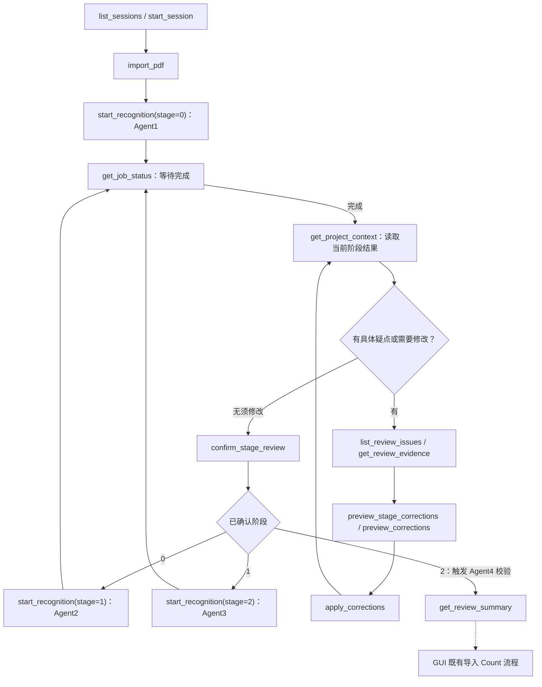

重要语义：

1. `stage=0/1/2` 对应 Agent1/2/3。`stage="all"` 每次选择一个接下来要执行的阶段，不会绕过阶段审阅连续跑完。
2. 后续阶段启动时，桥接层检查前序阶段审阅记录和工作流确认状态。
3. 阶段审阅允许 `evidence_ids=[]`，可以先依据已有结果做分流分析；实际修改要求当前版本的图像证据覆盖修改页。
4. 上传或识别期间，桥接层拒绝纠错预览、提交和阶段确认等冲突操作。
5. Agent4 在 Agent3 确认后进入校验阶段；预览和结果汇总也会调用其校验服务。当前没有独立的 Agent4 MCP tool。

## 4. Agent 阶段与数据契约

这些 Agent 是工作流中的业务模块。其内部根据任务组合视觉模型、向量匹配和确定性算法；Agent4 执行本地校验计算。

| 阶段 | 输入 | 内部核心能力 | 输出 | 主要实现 |
| --- | --- | --- | --- | --- |
| Agent1 页面分类 | PDF、页数、分类向量库 | PDF 渲染、Embedding、相似度匹配 | `PageClassificationResult` | `page_classification.py` |
| Agent2 总图信息 | Overall Layout 页图像 | 表格定位、视觉结构化提取、完整性检查 | `OverallSiteExtraction` 序列 | `info_recognition/overall_site.py` |
| Agent3 元素识别 | Array Layout 图像、Tracker 定义、INV 参考、方向和设置 | YOLO、表格识别、名称读取与复核、几何构建 | `ElementRecognitionResult`、`ReviewedTree`、疑点 | `element_recognition/` |
| Agent4 结果校验 | 总图汇总数据、复核结构与表格参考 | Node / INV / Tracker 类型 / 总量比较 | `ValidationReport`、可导入结构 | `validation/` |

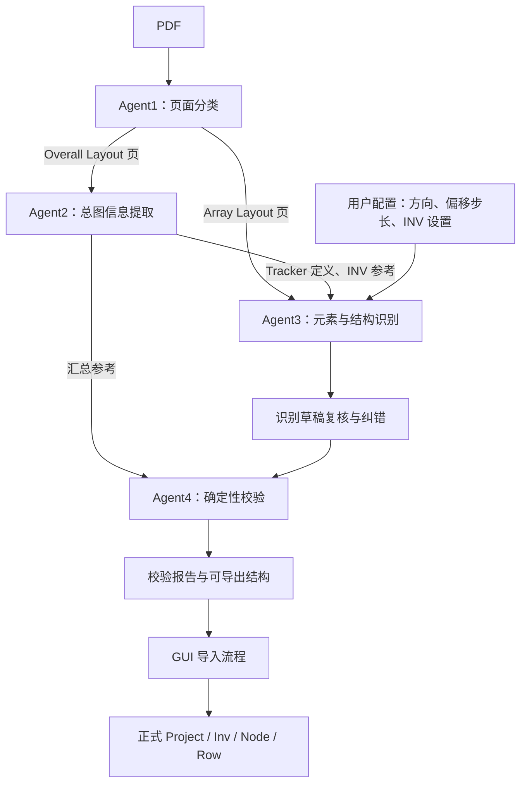

## 5. Agent1：页面分类内部流程

### 5.1 处理步骤

1. 校验 PDF 当前页数与上传时记录一致，加载 Embedding 客户端与分类参考向量。
2. 使用受控进程池渲染分类用页面图像和缩略图，并通过在途数量限制约束资源占用。
3. 检查视觉空白页；空白页直接记录分类结果，跳过 Embedding 请求。
4. 对非空白页，通过线程池并发请求图像 Embedding。
5. 归一化页面向量，与每个类别的平均向量和样本向量计算相似度。
6. 每个类别取“平均向量相似度”和“最佳样本相似度”的较大值，再选择最高分类。
7. 低于阈值时回退为未知类别 / `Other`；结果按原始页序聚合。
8. 若所有页均不可读，或没有相关工程图页，返回相应错误，保留明确诊断。

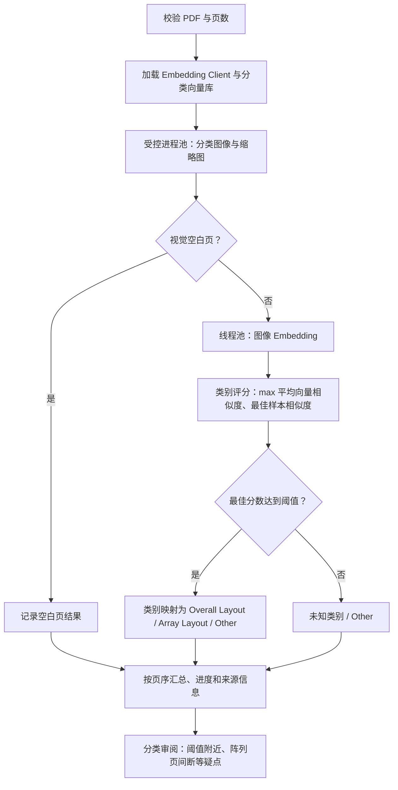

### 5.2 输出与复核关注点

输出包含页码、页面类型、类别评分、来源信息与缩略图；高分辨率图像由后续流程按需获取。分类参考由本地分类向量库提供，相关存储支持 SQLite。

分类分数是向量相似度，不是经过校准的概率。`StageReview.classification_review()` 提供阈值附近页面、阵列页间断和相邻页等线索，这些信息用于定位疑点，不能单凭页码连续性强行修改分类。

需要修改时使用 `preview_stage_corrections(stage=0)`。提交分类修改会使 Agent2、Agent3、Agent4 下游结果失效。

## 6. Agent2：总图信息识别内部流程

### 6.1 表格定位与提取

输入为 Agent1 识别出的 Overall Layout 页。主要读取 Tracker 规格/汇总信息和设备 INV 信息，为 Agent3 提供类型定义与设备参考，为 Agent4 提供独立汇总参考。

代码默认策略是 `yolo_glm`。可配置策略包括 `yolo_glm`、`yolo_claude`、`mineru_glm`、`mineru_claude`。GLM 经 OpenRouter 调用，Claude 经 Bedrock 调用，实际端点和模型由配置决定。

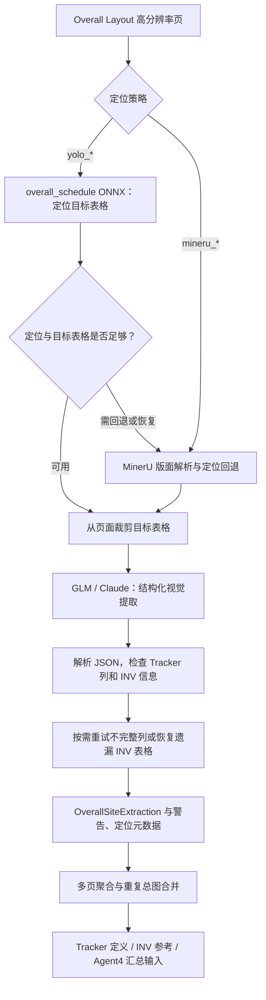

定位回退和恢复是按结果触发的分支；一次成功请求无需执行所有回退步骤。多页总图有批量准备和提取路径，单页走单页提取路径，之后统一合并重复总图，避免重复统计。

### 6.2 主要数据

| 信息 | 用途 |
| --- | --- |
| `tracker_ocr_fields` | 保存组件型号、功率、串数及计数等结构化字段 |
| `inv_list` 与兼容结构字段 | 为 INV 身份匹配、审阅与契约检查提供参考 |
| `warnings` 与原始诊断 | 提示缺失、不完整或无法确定的信息 |
| 表格 bbox、来源页与模型元数据 | 回溯原图位置、生成证据、定位错误 |
| 派生 Tracker 定义与汇总 | 供 Agent3 几何分类和 Agent4 数量比较使用 |

当前默认提示词主要要求读取 Tracker 信息和 INV 标识列表；内部数据模型仍有兼容的 `inv_rows` 等字段。字段是否具备真实提取值，应以返回的上下文为准。

需要修改时使用 `preview_stage_corrections(stage=1)`，按上下文结构提交完整提取列表，并覆盖所有 Overall Layout 页。提交后 Agent3、Agent4 下游结果失效。

## 7. Agent3：元素识别、名称理解与几何构建

Agent3 是内部最复杂的阶段。它将视觉检测、表格参考和名称匹配组合成可编辑的工程结构草稿。

### 7.1 输入与执行边界

`ElementRecognitionRequest` 携带阵列页、Tracker 定义、预期 INV、方向和 INV 专属设置等信息。生产路径通过 `Agent3ProcessRunner` 启动 `spawn` 子进程，使用单向 Pipe 向父进程传递进度和结果。

取消时可以终止该子进程，从而打断进程内正在运行的阻塞 HTTP 或 ONNX 工作。通过依赖注入提供的识别器仍可采用进程内执行路径，主要用于测试和集成。

### 7.2 单页内部处理框架

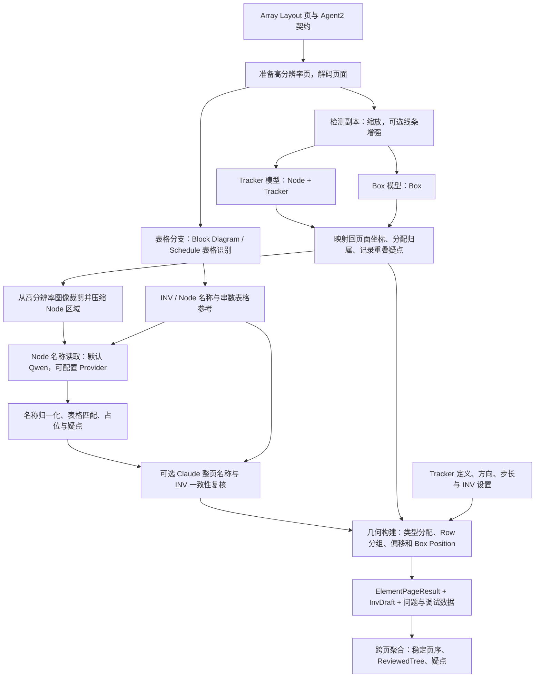

### 7.3 表格识别分支

`BlockDiagramTableRecognizer` 默认采用 `yolo_claude`。还支持 `yolo_glm`、`mineru_claude`。YOLO 使用 `block_schedule` 模型定位，低可信度或定位异常时按实现进入 MinerU 回退；之后裁剪区域，交给配置的视觉模型提取 INV、Node 和串数等字段。

表格不仅是最终校验参考，也用于约束 Node 名称读取，因此存在真实的数据依赖：**表格结果 → Node 名称读取 → 整页名称复核 → 几何构建**。

### 7.4 检测、归属与名称

- `node_tracker_yolov8n.onnx` 检测 Node / Tracker，`box_yolov8n.onnx` 检测 Box。
- 检测使用缩放副本，结果映射回完整页面坐标。可选线条增强只作用于 Tracker / Box 检测副本。
- Tracker 优先根据中心点包含关系归属 Node；Box 使用包含关系，再按最近且未配对的 Node 边缘进行补充分配。
- 归属失败、检测框重叠、缺少 Tracker / Box 或一个 Node 对应多个 Box 等情况进入问题列表。
- Node 名称读取保留原图方向，当前服务路径使用单一原始方向读取。默认通过 Qwen，配置 `LLM_PROVIDER` 后可切换支持的 Provider。
- 名称归一化支持设备标识组件顺序变化，并与表格名称匹配。无匹配或读取失败时保留可追踪的占位名称和疑点。
- 可选 Claude 整页复核使用页面、表格行、编号、候选名称及 bbox 检查一致性；失败时保留已有读取结果并记录问题。

### 7.5 几何构建如何形成业务结构

`_build_node()` 与 `geometry.py` 将检测和表格信息转换为 `NodeDraft` / `RowDraft`：

1. 根据 Tracker 长度、候选类型和表格串数约束尝试分配 Tracker 类型；失败时记录平衡问题。
2. 识别 Tracker 排列主轴、分组形成 Row，并估计行间距。
3. 使用类型定义换算相对串长尺度，结合方向、Box 和步长计算 Racking 条目及偏移。
4. 根据 Box 相对 Row 的位置计算 `box_position`；单 Row 无可靠行距时采用专门处理并提示歧义。
5. 从生成的 Rows 派生结构 Tracker 计数，同时保留独立的表格 OCR 串数，供 Agent4 对比。
6. 保存来源页、实体 ID、bbox、模型来源、识别状态和问题。

### 7.6 单个 Agent3 内部的并发

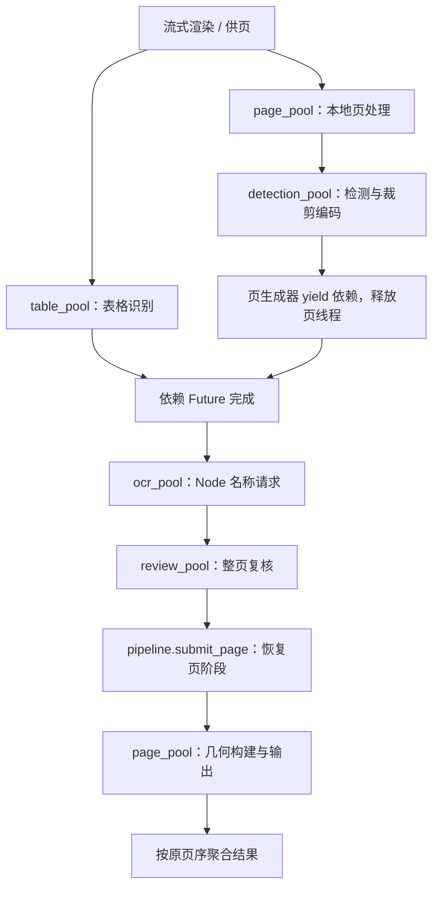

该图按单页依赖关系展开；多个页面可交叠执行。等待网络 Future 时页生成器退出本地工作线程，依赖完成后再恢复，避免慢表格或 OCR 长时间占住页处理线程。裁剪压缩后尽早释放完整位图，线程池及 YOLO 路由继续约束在途工作量和 CPU 预算。

## 8. Agent4：确定性校验与正式项目导入

Agent4 的主要入口为 `Agent4ValidationService.validate()`。输入包含 Agent2 汇总参考和 Agent3 复核结构/表格数据，输出 `ValidationReport`。

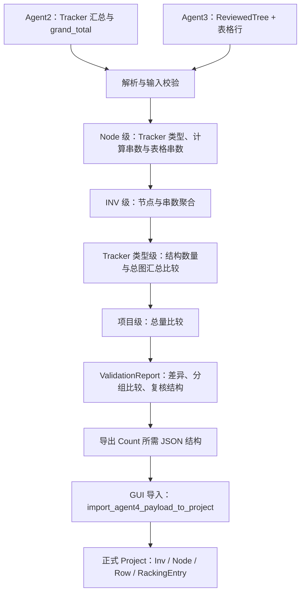

关键行为：

- 对表格存在而结构中未匹配的 Node 行，仍保留比较记录，避免漏检项在报告中消失。
- 结构计数和 OCR 参考分别保存，避免把结构计算值覆盖到参考字段后形成自我比较。
- Agent3 阶段确认进入 Validation 时会生成校验报告；纠错预览与汇总也可校验候选或当前结果。
- `validation_report_to_export_payload()` 生成项目类型、长度标识与 INV/Node/Row 结构。
- 既有 GUI 导入调用 `import_agent4_payload_to_project()`，更新正式项目树、合并长度标识并重新绑定引用。当前 MCP 工具集中没有独立的导入 Count 工具。

## 9. 纠错闭环：证据、预览、提交与发布验证

### 9.1 处理框架

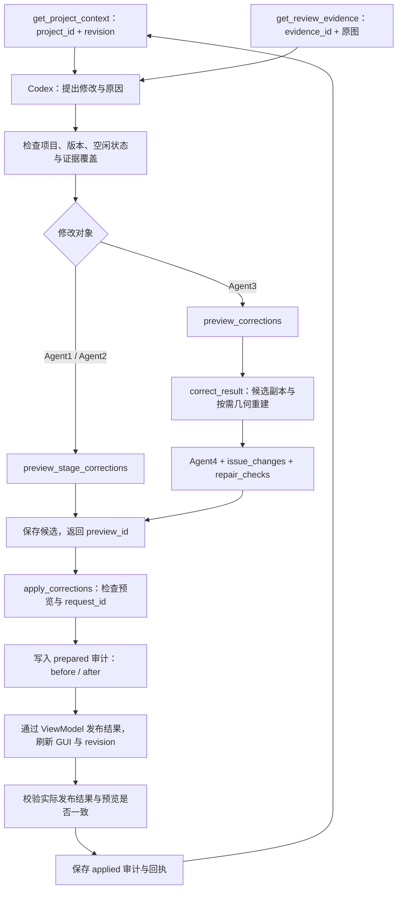

几何修改复用生产构建算法。预览只重建几何或计数输入变化的 Node，并检查无关页面与未显式删除的 Node 没有丢失。阶段修改则通过既有分类和提取结果更新方法发布，并使下游结果失效。

### 9.2 Agent3 支持的语义操作

下面的操作作为 `preview_corrections.operations` 传入。它们是同一工具的数据项。

| `op` | 业务含义 |
| --- | --- |
| `initialize_page` | 恢复缺失输出的阵列页，要求原图尺寸和预期 INV |
| `add_detection` | 增加 Node、Tracker 或 Box |
| `update_detection` | 修改 bbox 或父级归属 |
| `delete_detection` | 删除 Tracker 或 Box |
| `rename_node` | 修改 Node 名称 |
| `delete_node` | 删除已无子设备的 Node |
| `rename_inv` | 修改仅属于指定页的 INV 名称 |
| `replace_table_rows` | 替换页面表格行 |
| `mark_node_for_review` | 保存不能确定的 Node 线索，进入人工待处理队列 |
| `resolve_node_review` | 显式解除指定人工待处理项 |

增加 Node 后，应先提交并获得其实际实体 ID，再添加或迁移子设备。人工待处理项保留在问题和导出清单中，不计入正式设备数量。

### 9.3 一致性标识

| 标识 | 约束 |
| --- | --- |
| `window_id` | 选择目标桌面窗口 |
| `project_id` | 约束目标识别项目，防止跨项目修改 |
| `base_revision` | 必须等于当前版本，防止覆盖新结果 |
| `evidence_ids` | 必须属于当前版本并覆盖所有修改页 |
| `preview_id` | 指向当前版本已计算好的候选修改 |
| `request_id` | 当前应用会话内幂等；同 ID 同请求返回原回执，同 ID 不同请求拒绝 |

用户修改结果、重新识别、分类/提取数据或相关设置改变时，`ReviewSession.sync()` 更新 revision、清除旧预览并使相应下游审阅失效。旧证据索引可能仍在内存中，但其 revision 检查无法通过。纯进度通知不改变这些业务版本。

工具输入 bbox 为完整渲染页面上的归一化 `xyxy`，左上为原点，页码从 1 开始。裁剪图片不改变坐标基准。内部完整结果和审计可能保留像素坐标，应使用页面 `image_width` / `image_height` 换算。

## 10. 多窗口、任务调度与持久化

### 10.1 窗口选择与跨窗口调度

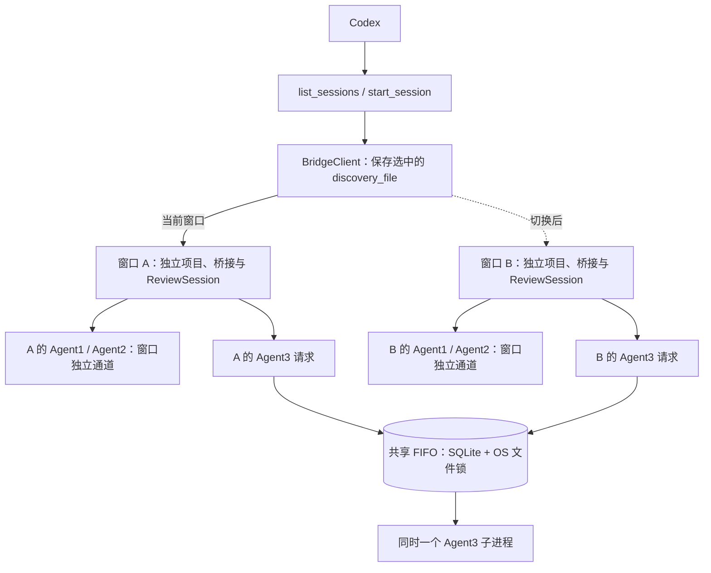

`start_session(new_window=True)` 创建独立窗口；`start_session(window_id=...)` 选择已列出的窗口。未选择且有多个窗口时要求明确选择。后续工具使用该客户端当前窗口，写入流程中应保持窗口选择稳定。

存在两套不同层面的队列：

| 队列 | 范围 | 用途 |
| --- | --- | --- |
| GuiBridge 请求队列 | 每个窗口独立 | 将 HTTP 调用排入 Qt 主线程 |
| Recognition 准入队列 | Agent1/2 窗口独立；Agent3 跨窗口共享 | 控制识别运行资格，限制 Agent3 内存叠加 |

同一窗口同时运行一个阶段。Agent3 等待期间不会启动对应子进程、加载模型或渲染高分辨率页面。释放 Agent3 运行资格前需要确认原工作线程和子进程已经退出；取消所选窗口任务不取消其他窗口任务。

### 10.2 状态与文件

| 状态或文件 | 所在位置与生命周期 |
| --- | --- |
| 识别快照与当前结果 | GUI 的 Workflow / ViewModel |
| jobs、预览、证据索引、幂等回执 | GUI 内存；重启后不自动恢复 |
| `bridge.json` | 每个窗口的运行目录；保存连接信息 |
| 证据图片与 `evidence.json` | `projects/<project_id>/evidence/` |
| 纠错 before/after 与回执 | `projects/<project_id>/corrections/` |
| 阶段审阅记录 | `projects/<project_id>/stage-reviews.json`；当前无重启恢复流程 |
| 复核结果 | `projects/<project_id>/reviewed-result.json` |
| 人工待处理清单 | `projects/<project_id>/manual-review.json` |
| 正式 Count 项目 | 项目 JSON，包含领域数据、版本历史和完整性信息 |

上述 `projects/` 位于各窗口桥接文件同级。源码默认运行根目录是 `.codex-runtime`；打包版默认位于用户本地应用数据的 `CountAndDesign/runtime` 下，独立窗口还有各自子目录。

## 11. 结果状态的含义与当前边界

- `job.status=completed`：识别阶段已产出结果，仍需审阅。
- `review_complete`：Agent1、Agent2、Agent3 审阅记录均已存在。
- `repair_complete`：当前 `repair_checks` 定义的结构/数量、方向、INV 与问题条件通过。
- `preview_matches_published`：实际发布的页面与复核树和候选预览一致。

这些状态各有用途。数量一致、问题记录减少或提交成功，都需要结合原图与业务疑点判断视觉准确性。表格与检测均遗漏的 Node，可能无法由二者对账发现；已有来源线索应保留在人工待处理清单中。

当前支持证据驱动的分类、提取结果、检测与结构纠错，以及失败阵列页恢复；没有自动回滚工具。MCP 调用读取和修改的是选中窗口的识别状态，正式 Count 导入继续走现有 GUI 流程。

## 12. 关键源码索引

以下链接相对于本文所在的 `docs/` 目录，可在仓库 Markdown 查看器中跳转。

| 模块 | 源码 |
| --- | --- |
| EXE / 模块入口分流 | [__main__.py](../src/count_and_design/__main__.py) |
| GUI 启动与桥接安装 | [main.py](../src/count_and_design/main.py) |
| MCP 工具与客户端 | [mcp_server.py](../src/count_and_design/integration/mcp_server.py) |
| 运行路径、发现文件与启动参数 | [runtime.py](../src/count_and_design/integration/runtime.py) |
| HTTP、Qt 分发与 jobs | [gui_bridge.py](../src/count_and_design/integration/gui_bridge.py) |
| revision、证据、预览与提交 | [review_session.py](../src/count_and_design/integration/review_session.py) |
| Agent1/2 修正与阶段确认 | [stage_review.py](../src/count_and_design/integration/stage_review.py) |
| 语义纠错与几何重建 | [corrections.py](../src/count_and_design/integration/corrections.py) |
| 修复检查与问题差异 | [verification.py](../src/count_and_design/integration/verification.py) |
| AI 状态与后台任务协调 | [ai_statistics.py](../src/count_and_design/gui/viewmodels/ai_statistics.py) |
| Agent1–4 工作流 | [workflow.py](../src/count_and_design/application/ai_statistics/workflow.py) |
| Agent1 分类 | [page_classification.py](../src/count_and_design/application/ai_statistics/page_classification.py) |
| 分类向量评分与存储 | [category_vectors.py](../src/count_and_design/application/ai_statistics/category_vectors.py)、[vector_store.py](../src/count_and_design/application/ai_statistics/vector_store.py) |
| PDF 渲染 | [pdf_rendering.py](../src/count_and_design/application/ai_statistics/pdf_rendering.py) |
| Agent2 总图提取 | [overall_site.py](../src/count_and_design/application/ai_statistics/info_recognition/overall_site.py) |
| Agent3 主流程 | [service.py](../src/count_and_design/application/ai_statistics/element_recognition/service.py) |
| Agent3 子进程与页调度 | [process_runner.py](../src/count_and_design/application/ai_statistics/element_recognition/process_runner.py)、[pipeline.py](../src/count_and_design/application/ai_statistics/element_recognition/pipeline.py) |
| Agent3 表格识别 | [recognizer.py](../src/count_and_design/application/ai_statistics/element_recognition/block_diagram_table/recognizer.py) |
| Agent3 名称读取与整页复核 | [recognizer.py](../src/count_and_design/application/ai_statistics/element_recognition/node_label/recognizer.py)、[reviewer.py](../src/count_and_design/application/ai_statistics/element_recognition/node_label/reviewer.py) |
| Agent3 几何算法 | [geometry.py](../src/count_and_design/application/ai_statistics/element_recognition/geometry.py) |
| Agent4 校验与导入 | [service.py](../src/count_and_design/application/ai_statistics/validation/service.py)、[import_to_count.py](../src/count_and_design/application/ai_statistics/validation/import_to_count.py) |
| 跨窗口识别队列 | [recognition_queue.py](../src/count_and_design/application/recognition_queue.py) |
| 模型策略与环境配置 | [config.py](../src/count_and_design/application/config.py) |

相关说明：[Codex 接入与复核](CODEX_INTEGRATION.md)、[Agent1 页面分类](AGENT1_PAGE_CLASSIFICATION.md)、[Agent2 总图策略](AGENT2_OVERALL_SITE_VISION.md)、[Agent3 并发](AGENT3_CONCURRENCY.md)、[Block Diagram 表格流程](BLOCK_DIAGRAM_TABLE_FLOW.md)。
